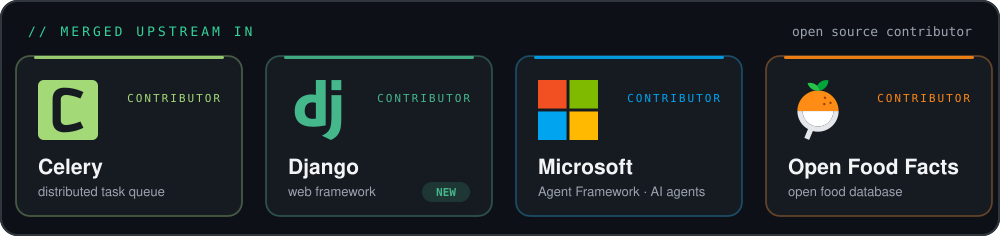
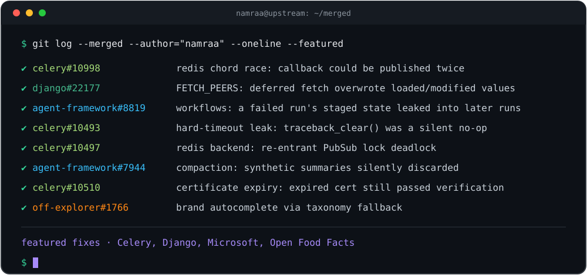
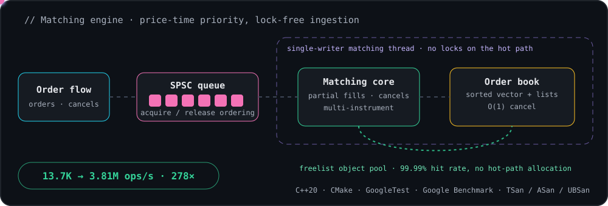
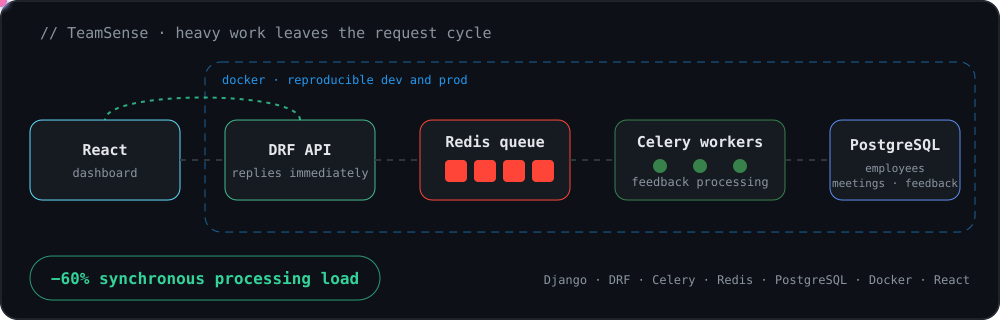
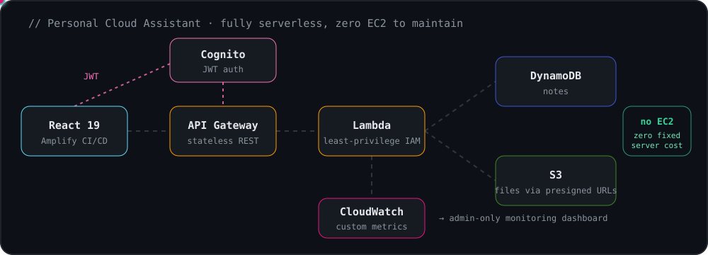

<div align="center">


**I work on backend reliability and systems correctness: tracing race conditions, state leaks and memory bugs, then shipping small, tested fixes upstream.**

[](https://github.com/celery/celery/pulls?q=is%3Apr+author%3ANamraa310806+is%3Amerged)
[](https://github.com/django/django/pulls?q=is%3Apr+author%3ANamraa310806+is%3Amerged)
[](https://github.com/microsoft/agent-framework/pulls?q=is%3Apr+author%3ANamraa310806+is%3Amerged)
[](https://github.com/openfoodfacts/openfoodfacts-explorer/pulls?q=is%3Apr+author%3ANamraa310806+is%3Amerged)

[](https://github.com/Namraa310806)
[](https://namraa310806.github.io/Portfolio/)
[](https://www.linkedin.com/in/namraa-patel/)
[](https://codeforces.com/profile/hacker08)
[](https://leetcode.com/u/patelnamraa08/)
[](mailto:patelnamraa88@gmail.com)



<a href="#snapshot"><b>Snapshot</b></a> · <a href="#upstream"><b>Upstream work</b></a> · <a href="#systems"><b>Systems</b></a> · <a href="#projects"><b>Projects</b></a> · <a href="#experience"><b>Experience</b></a> · <a href="#contact"><b>Contact</b></a>


</div>

## `> choose your path`

<details open>
<summary><b>I'm a recruiter — the 20-second snapshot</b></summary>

- **Target roles:** Summer 2027 SDE / Backend / ML internships
- **Education:** B.Tech, Computer Science & Business Systems at PDEU — **9.61/10**, expected May 2028; Diploma in Computer Science — **9.78/10**
- **Upstream engineering:** Contributions to Celery, Django, Microsoft Agent Framework and Open Food Facts, including fixes for concurrency, ORM state, workflow isolation and memory handling
- **Systems:** C++20 limit order book and matching engine — **278× throughput improvement** on a cancel-heavy workload; tested with ASan, UBSan and TSan
- **Industry experience:** Django backend internship; database indexing and ORM tuning reduced average API response time by **25%** under production load
- **Achievements:** JPMorgan Chase Code for Good 2026 winner; Google The Big Code 2026 Round 2; Amazon ML Challenge 2025 top 2,500 of 30,000+
- **Competitive programming:** Codeforces Expert (**1704**); LeetCode (**2207**)
- **Contact:** [patelnamraa88@gmail.com](mailto:patelnamraa88@gmail.com)

</details>

<details>
<summary><b>I'm an engineer — show me the technical work</b></summary>

Start with the [upstream bug investigations](#upstream): a Redis chord race in Celery, a deferred-field overwrite in Django, failed-superstep state leaking across Agent Framework workflow runs, and a traceback/frame reference cycle. Then explore the [C++ matching engine](#matching-engine), including its lock-free SPSC ingestion queue and sanitizer-driven debugging.

</details>

<details>
<summary><b>I'm a maintainer — what is my contribution style?</b></summary>

I focus on reproducing the failure, understanding the invariant that was broken, keeping the patch scoped, and adding regression tests. I value review feedback and prefer a smaller, well-tested fix over a broad refactor when the smaller change solves the underlying problem.

</details>

## `> whoami`

```text
$ whoami

namraa@upstream

focus      backend reliability · systems correctness
interests  concurrency · memory · shared state · distributed systems
approach   reproduce → isolate root cause → minimal fix → regression tests
upstream   Celery · Django · Microsoft Agent Framework · Open Food Facts
builds     C++ matching engine · async backend systems · cloud applications
status     open to Summer 2027 SDE / Backend / ML internships
```

<a id="snapshot"></a>

## `> engineering snapshot`

<div align="center">

| **278×** | **25%** | **9.61/10** |
|:---:|:---:|:---:|
| matching throughput gain | API latency reduction | B.Tech CGPA |



</div>

<a id="upstream"></a>

## `> upstream engineering`

I contribute fixes and features to production repositories, with particular interest in correctness under concurrency, state lifecycle, memory behavior and failure handling.

### Bug investigations

| Failure | Repository | Root cause / fix | Merged PR |
|:---|:---|:---|:---|
| Redis chord callback could publish twice | Celery | Made completion detection and dispatch an atomic Lua-scripted claim; added unique claim tokens and ownership-validated cleanup | [#10998](https://github.com/celery/celery/pull/10998) |
| Deferred fetch overwrote existing values | Django | Prevented `FETCH_PEERS` from overwriting already-loaded or locally modified values; kept the change scoped to `DeferredAttribute` | [#22177](https://github.com/django/django/pull/22177) |
| Failed workflow superstep leaked staged writes | Microsoft Agent Framework | Discarded pending state after failure or cancellation across core, declarative and foundry-hosting packages | [#8819](https://github.com/microsoft/agent-framework/pull/8819) |
| Hard-timeout traceback/frame reference cycle | Celery | Replaced ineffective traceback clearing with `exc.__traceback__ = None` and added regression/smoke tests | [#10493](https://github.com/celery/celery/pull/10493) |
| Redis result consumer deadlocked | Celery | Guarded a redundant `UNSUBSCRIBE` path that re-entered a non-reentrant lock | [#10497](https://github.com/celery/celery/pull/10497) |
| Synthetic compaction summaries disappeared | Microsoft Agent Framework | Reworked `before_run` reconciliation so summaries survive subsequent agent runs | [#7944](https://github.com/microsoft/agent-framework/pull/7944) |
| Certificate expiry during verification | Celery | Added an explicit expiry check before certificate verification | [#10510](https://github.com/celery/celery/pull/10510) |

<div align="center">

### A closer look at two failure modes





</div>

<details>
<summary><b>Upstream contribution index</b></summary>

**Celery**

| PR | Contribution |
|:---|:---|
| [#10998](https://github.com/celery/celery/pull/10998) | Redis chord claim cleanup ownership |
| [#10884](https://github.com/celery/celery/pull/10884) | Stamped header revocation |
| [#10876](https://github.com/celery/celery/pull/10876) | Task execution after ETA conversion failure |
| [#10866](https://github.com/celery/celery/pull/10866) | Database backend cleanup timezone |
| [#10836](https://github.com/celery/celery/pull/10836) | Avoid `get_state` for plain chain failures |
| [#10822](https://github.com/celery/celery/pull/10822) | Redact Azure credentials in diagnostic output |
| [#10701](https://github.com/celery/celery/pull/10701) | Handle missing ArangoDB documents on delete |
| [#10520](https://github.com/celery/celery/pull/10520) | Pre-commit formatting fix in `test_time` |
| [#10513](https://github.com/celery/celery/pull/10513) | Handle invalid worker environment values |
| [#10510](https://github.com/celery/celery/pull/10510) | Certificate expiration during verification |
| [#10497](https://github.com/celery/celery/pull/10497) | Redis result consumer redundant unsubscribe |
| [#10493](https://github.com/celery/celery/pull/10493) | Ineffective traceback clearing in timeout handling |
| [#10461](https://github.com/celery/celery/pull/10461) | Shared `retry_kwargs` mutation in autoretry |

**Microsoft Agent Framework**

| PR | Contribution |
|:---|:---|
| [#9796](https://github.com/microsoft/agent-framework/pull/9796) | Bedrock parallel tool result handling |
| [#9469](https://github.com/microsoft/agent-framework/pull/9469) | Stateless shell tools inheriting host stdin |
| [#8819](https://github.com/microsoft/agent-framework/pull/8819) | Discard pending state after failed workflow supersteps |
| [#7944](https://github.com/microsoft/agent-framework/pull/7944) | Preserve synthetic compaction summaries |
| [#7901](https://github.com/microsoft/agent-framework/pull/7901) | Prevent input mutation in `SerializationMixin.from_dict` |

**Open Food Facts Explorer**

| PR | Contribution |
|:---|:---|
| [#1766](https://github.com/openfoodfacts/openfoodfacts-explorer/pull/1766) | Brand autocomplete via classic taxonomy fallback |
| [#1851](https://github.com/openfoodfacts/openfoodfacts-explorer/pull/1851) | Preserve missing country data in countries map |
| [#1225](https://github.com/openfoodfacts/openfoodfacts-explorer/pull/1225) | Add role and tabindex to crop resize handles |

**Django**

| PR | Contribution |
|:---|:---|
| [#22177](https://github.com/django/django/pull/22177) | Avoid overwriting values when `FETCH_PEERS` fetches deferred fields |

</details>

<details>
<summary><b>Selected additional merged work</b> · security, reliability, APIs and RAG</summary>

The contribution export also includes work across collaborative repositories. A few representative examples:

| Area | Repository | Selected merged PRs |
|:---|:---|:---|
| Authentication and rate limiting | [LegalEase](https://github.com/AnuranjanJain/LegalEase) | [Redis-backed distributed rate limiting #441](https://github.com/AnuranjanJain/LegalEase/pull/441) · [strict JWT/API-key separation #398](https://github.com/AnuranjanJain/LegalEase/pull/398) · [stream uploads to disk #207](https://github.com/AnuranjanJain/LegalEase/pull/207) |
| Application security and runtime reliability | [Eventra](https://github.com/SandeepVashishtha/Eventra) | [distributed rate limiting #8374](https://github.com/SandeepVashishtha/Eventra/pull/8374) · [CSRF enforcement #8150](https://github.com/SandeepVashishtha/Eventra/pull/8150) · [secure storage lifecycle #8152](https://github.com/SandeepVashishtha/Eventra/pull/8152) |
| RAG and document processing | [pdf-qa-bot](https://github.com/FireFistisDead/pdf-qa-bot) | [SSRF hostname validation #403](https://github.com/FireFistisDead/pdf-qa-bot/pull/403) · [HttpOnly session cookies #404](https://github.com/FireFistisDead/pdf-qa-bot/pull/404) · [remove unsafe FAISS deserialization #388](https://github.com/FireFistisDead/pdf-qa-bot/pull/388) |
| Webhook and runtime hardening | [pathfinder-ai](https://github.com/harshdwivediiiii/pathfinder-ai) | [verify Clerk webhook signatures with Svix #2268](https://github.com/harshdwivediiiii/pathfinder-ai/pull/2268) · [remove private Node.js timer internals #2262](https://github.com/harshdwivediiiii/pathfinder-ai/pull/2262) |
| Async runtime and state correctness | [AegisGraph Sentinel](https://github.com/Puneet04-tech/AegisGraph-Sentinel-2.0) | [synchronize shared runtime state across async services #1054](https://github.com/Puneet04-tech/AegisGraph-Sentinel-2.0/pull/1054) · [lifecycle state consistency and validation #1058](https://github.com/Puneet04-tech/AegisGraph-Sentinel-2.0/pull/1058) |

</details>

<a id="systems"></a>

## `> systems engineering`

<a id="matching-engine"></a>

### [Limit Order Book & Matching Engine](https://github.com/Namraa310806/Matching-Engine) · C++20

<div align="center">



</div>

A price-time-priority matching engine supporting limit and market orders, partial fills, cancellations and multiple instruments.

- **278× throughput improvement on cancel-heavy load:** replaced a map/deque order book with a sorted-vector plus intrusive-list design, improving cancellation to O(1); measured **13.7K → 3.81M ops/s**.
- **Allocation efficiency:** a chunked freelist object pool reached a **99.99% hit rate**, adding **22–49% throughput** and up to **5× lower variance**. Profiling-led tuning added another 15%; regressing experiments were reverted.
- **Concurrency correctness:** designed a lock-free SPSC ingestion queue with acquire/release ordering and a single-writer matching thread. ThreadSanitizer exposed a real memory-ordering race, which I fixed.
- **Validation:** caught a silent-drop flaw in my own benchmark and added `submitted = processed` checks; completed **490 test runs** under ASan, UBSan and TSan.

`C++20` `CMake` `GoogleTest` `Google Benchmark` `ASan` `UBSan` `TSan`

<a id="projects"></a>

## `> selected projects`

### [TeamSense](https://github.com/Namraa310806/TeamSense) · Async task pipeline for HR analytics

<div align="center">

</div>

- Built an asynchronous Celery + Redis pipeline to move compute-heavy feedback processing out of the request cycle, reducing synchronous processing load by **60%**.
- Designed a multi-entity PostgreSQL schema for employees, meetings and feedback; containerized the stack with Docker for reproducible environments.

`Django` `DRF` `Celery` `Redis` `PostgreSQL` `Docker` `React`

### [Personal Cloud Assistant](https://github.com/Namraa310806/AWSPeronsalCloudAssistant) · Serverless AWS application

<div align="center">

</div>

- Built a notes-and-files backend with AWS Lambda and API Gateway, DynamoDB and S3 presigned download URLs.
- Secured access with Cognito JWT authentication and least-privilege IAM roles.
- Added CloudWatch custom metrics for operation counts, request duration and errors behind an admin-only dashboard; shipped a React 19 frontend with Amplify CI/CD.

`AWS Lambda` `API Gateway` `DynamoDB` `S3` `Cognito` `CloudWatch` `React`

### [ProfiLens](https://github.com/Namraa310806/ProfiLens) · Career-preparation platform

- Built a normalized, indexed PostgreSQL schema for user progress and gamification data, with role-based access control and session-scoped permissions.
- Added a background ReportLab pipeline for certificate and resume generation.

`Django` `DRF` `PostgreSQL` `ReportLab`

<a id="experience"></a>

## `> experience & education`

| Experience | Details |
|:---|:---|
| **Django Backend Intern** · Techaronic IT Solutions | Ahmedabad · Jun–Aug 2024. Tuned database indexes and ORM queries, reducing average API response time by **25%** under production load; implemented authentication/authorization workflows; deployed and debugged AWS EC2 services under live traffic. |
| **B.Tech — Computer Science & Business Systems** · Pandit Deendayal Energy University | Gandhinagar · **9.61/10** · Expected May 2028 |
| **Diploma Engineering — Computer Science** · Government Polytechnic Ahmedabad | Ahmedabad · **9.78/10** · Aug 2022–Apr 2025 |

## `> technology stack`

I use tools to solve the problem in front of me—not to collect logos. These are the languages, frameworks and infrastructure technologies reflected in my projects, contributions and experience.

<div align="center">

**Languages**


**Backend, data and messaging**


**Frontend**


**Cloud, infrastructure and developer tools**


**AI / ML**


</div>

| Area | Tools and concepts |
|:---|:---|
| **Languages** | Python · C++ · Java · JavaScript · TypeScript · PHP |
| **Backend** | Django · Django REST Framework · FastAPI · Flask · REST APIs · Celery |
| **Data and messaging** | PostgreSQL · MySQL · MongoDB · Redis |
| **Cloud and infrastructure** | AWS (EC2, Lambda, S3, DynamoDB, IAM, Cognito, API Gateway, CloudWatch) · Oracle Cloud Infrastructure · Docker · Kubernetes · Linux · Git |
| **AI / ML** | TensorFlow · scikit-learn · pandas · RAG · Transformer models · Hugging Face · Model evaluation |
| **Systems and tooling** | C++20 · CMake · GoogleTest · Google Benchmark · ASan · UBSan · TSan |
| **Computer science** | Data structures and algorithms · Concurrency and correctness · OOP · DBMS · Operating systems · Computer networks · System design |

> I keep this list focused on technologies I have used in projects, coursework, contributions or hands-on experience. A logo is not a claim of production-level expertise.

## `> engineering interests`

- **Backend reliability & distributed systems** — async execution, task queues, retries, failure handling and state consistency.
- **Systems programming & performance** — concurrency, memory behavior, data structures, profiling and measurable optimization.
- **AI-powered applications** — practical ML, retrieval-augmented generation and agent workflows.
- **Open-source infrastructure** — debugging real-world issues, writing regression tests and collaborating with maintainers.

## `> achievements`

<div align="center">

</div>

- **JPMorgan Chase Code for Good 2026:** Winner; built a production-ready solution for a nonprofit partner.
- **Google The Big Code 2026:** Qualified for Round 2.
- **Amazon ML Challenge 2025:** Top 2,500 among 30,000+ participants.
- **Open Source Hackathon:** Winner; delivered production-ready features under time constraints.
- **Hackout 2025:** Finalist on technical merit.
- **Certifications:** Oracle Cloud Infrastructure Generative AI Professional; Oracle Data Science Professional.

<a id="contact"></a>

## `> contact`

<div align="center">

<a href="mailto:patelnamraa88@gmail.com">
  
</a>

**[GitHub](https://github.com/Namraa310806) · [LinkedIn](https://www.linkedin.com/in/namraa-patel/) · [Portfolio](https://namraa310806.github.io/Portfolio/) · [Email](mailto:patelnamraa88@gmail.com)**

</div>
