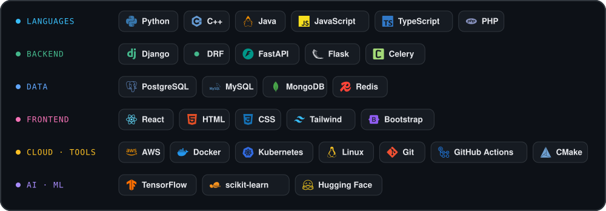

<div align="center">


**I work on backend reliability and systems correctness: tracing race conditions, state leaks and memory bugs, then shipping small, tested fixes upstream.**

[](https://github.com/celery/celery/pulls?q=is%3Apr+author%3ANamraa310806+is%3Amerged)
[](https://github.com/django/django/pulls?q=is%3Apr+author%3ANamraa310806+is%3Amerged)
[](https://github.com/microsoft/agent-framework/pulls?q=is%3Apr+author%3ANamraa310806+is%3Amerged)
[](https://github.com/openfoodfacts/openfoodfacts-explorer/pulls?q=is%3Apr+author%3ANamraa310806+is%3Amerged)

[](https://github.com/Namraa310806)
[](https://namraa310806.github.io/Portfolio/)
[](https://www.linkedin.com/in/namraa-patel/)
[](https://codeforces.com/profile/hacker08)
[](https://leetcode.com/u/patelnamraa08/)
[](mailto:patelnamraa88@gmail.com)


<a href="#snapshot"><b>Snapshot</b></a> · <a href="#upstream"><b>Upstream work</b></a> · <a href="#systems"><b>Systems</b></a> · <a href="#projects"><b>Projects</b></a> · <a href="#experience"><b>Experience</b></a> · <a href="#contact"><b>Contact</b></a>


</div>

## `> choose your path`

<details open>
<summary><b>I'm a recruiter — the 20-second snapshot</b></summary>

- **Target roles:** Summer 2027 SDE / Backend / ML internships
- **Education:** B.Tech, Computer Science & Business Systems at PDEU — **9.61/10**, expected May 2028; Diploma in Computer Science — **9.78/10**
- **Upstream engineering:** Contributions to Celery, Django, Microsoft Agent Framework and Open Food Facts, including fixes for concurrency, ORM state, workflow isolation and memory handling
- **Systems:** C++20 limit order book and matching engine — **278× throughput improvement** on a cancel-heavy workload; tested with ASan, UBSan and TSan
- **Industry experience:** Django backend internship; database indexing and ORM tuning reduced average API response time by **25%** under production load
- **Achievements:** JPMorgan Chase Code for Good 2026 winner; Google The Big Code 2026 Round 2; Amazon ML Challenge 2025 top 2,500 of 30,000+
- **Competitive programming:** Codeforces Expert (max **1738**, current 1704); LeetCode (**2207**)
- **Contact:** [patelnamraa88@gmail.com](mailto:patelnamraa88@gmail.com)

</details>

<details>
<summary><b>I'm an engineer — show me the technical work</b></summary>

Start with the [upstream bug investigations](#upstream): a Redis chord race in Celery, a deferred-field overwrite in Django, failed-superstep state leaking across Agent Framework workflow runs, and a traceback/frame reference cycle. Then explore the [C++ matching engine](#matching-engine), including its lock-free SPSC ingestion queue and sanitizer-driven debugging.

</details>

<details>
<summary><b>I'm a maintainer — what is my contribution style?</b></summary>

I focus on reproducing the failure, understanding the invariant that was broken, keeping the patch scoped, and adding regression tests. I value review feedback and prefer a smaller, well-tested fix over a broad refactor when the smaller change solves the underlying problem. In Django, maintainer review shrank my patch to a change confined to `DeferredAttribute`, and the fix is better for it.

</details>

## `> whoami`

```text
$ whoami

namraa@upstream

focus      backend reliability · systems correctness
interests  concurrency · memory · shared state · distributed systems
approach   reproduce → isolate root cause → minimal fix → regression tests
upstream   Celery · Django · Microsoft Agent Framework · Open Food Facts
builds     C++ matching engine · async backend systems · cloud applications
status     open to Summer 2027 SDE / Backend / ML internships
```

<a id="snapshot"></a>

## `> engineering snapshot`

<div align="center">

| **278×** | **25%** | **9.61/10** |
|:---:|:---:|:---:|
| matching throughput gain | API latency reduction | B.Tech CGPA |


</div>

<a id="upstream"></a>

## `> upstream engineering`

I contribute fixes and features to production repositories, with particular interest in correctness under concurrency, state lifecycle, memory behavior and failure handling.

### Bug investigations

| Failure | Repository | Root cause / fix | Merged PR |
|:---|:---|:---|:---|
| Redis chord callback could publish twice | Celery | Made completion detection and dispatch an atomic Lua-scripted claim; added unique claim tokens and ownership-validated cleanup | [#10998](https://github.com/celery/celery/pull/10998) |
| Deferred fetch overwrote existing values | Django | Prevented `FETCH_PEERS` from overwriting already-loaded or locally modified values; kept the change scoped to `DeferredAttribute` | [#22177](https://github.com/django/django/pull/22177) |
| Failed workflow superstep leaked staged writes | Microsoft Agent Framework | Discarded pending state after failure or cancellation across core, declarative and foundry-hosting packages | [#8819](https://github.com/microsoft/agent-framework/pull/8819)<br/><sub>shipped in 1.22.0</sub> |
| Hard-timeout traceback/frame reference cycle | Celery | Replaced ineffective traceback clearing with `exc.__traceback__ = None` and added regression/smoke tests | [#10493](https://github.com/celery/celery/pull/10493)<br/><sub>shipped in 5.7.0</sub> |
| Redis result consumer deadlocked | Celery | Guarded a redundant `UNSUBSCRIBE` path that re-entered a non-reentrant lock | [#10497](https://github.com/celery/celery/pull/10497)<br/><sub>shipped in 5.7.0</sub> |
| Synthetic compaction summaries disappeared | Microsoft Agent Framework | Reworked `before_run` reconciliation so summaries survive subsequent agent runs | [#7944](https://github.com/microsoft/agent-framework/pull/7944)<br/><sub>shipped in 1.19.0</sub> |
| Certificate expiry during verification | Celery | Added an explicit expiry check before certificate verification | [#10510](https://github.com/celery/celery/pull/10510) |

<div align="center">

### A closer look at three failure modes




</div>

<p><a href="https://github.com/pulls?q=is%3Apr+is%3Amerged+author%3ANamraa310806"><b>Browse all my merged pull requests on GitHub →</b></a></p>

<details>
<summary><b>Selected contributions in other collaborative repositories</b></summary>

A few examples beyond the core upstream projects:

| Engineering area | Repository | Selected merged work |
|:---|:---|:---|
| Distributed rate limiting and authentication | [LegalEase](https://github.com/AnuranjanJain/LegalEase) | [Redis-backed rate limiting #441](https://github.com/AnuranjanJain/LegalEase/pull/441) · [strict JWT/API-key separation #398](https://github.com/AnuranjanJain/LegalEase/pull/398) |
| Application security | [Eventra](https://github.com/SandeepVashishtha/Eventra) | [CSRF protection and enforcement #8150](https://github.com/SandeepVashishtha/Eventra/pull/8150) |
| RAG security | [pdf-qa-bot](https://github.com/FireFistisDead/pdf-qa-bot) | [SSRF hostname validation #403](https://github.com/FireFistisDead/pdf-qa-bot/pull/403) · [remove unsafe FAISS deserialization #388](https://github.com/FireFistisDead/pdf-qa-bot/pull/388) |
| Async runtime and concurrency | [AegisGraph Sentinel](https://github.com/Puneet04-tech/AegisGraph-Sentinel-2.0) · [pathfinder-ai](https://github.com/harshdwivediiiii/pathfinder-ai) | [synchronize shared runtime state #1054](https://github.com/Puneet04-tech/AegisGraph-Sentinel-2.0/pull/1054) · [replace timer-based mutex polling with queued waiters #1388](https://github.com/harshdwivediiiii/pathfinder-ai/pull/1388) |
| Webhook verification | [pathfinder-ai](https://github.com/harshdwivediiiii/pathfinder-ai) | [verify Clerk webhook signatures using Svix #2268](https://github.com/harshdwivediiiii/pathfinder-ai/pull/2268) |

</details>

<a id="systems"></a>

## `> systems engineering`

<a id="matching-engine"></a>

### [Limit Order Book & Matching Engine](https://github.com/Namraa310806/Matching-Engine) · C++20

<div align="center">


</div>

A price-time-priority matching engine supporting limit and market orders, partial fills, cancellations and multiple instruments.

- **278× throughput improvement on cancel-heavy load:** replaced a map/deque order book with a sorted-vector plus intrusive-list design, improving cancellation to O(1); measured **13.7K → 3.81M ops/s**.
- **Allocation efficiency:** a chunked freelist object pool reached a **99.99% hit rate**, adding **22–49% throughput** and up to **5× lower variance**. Profiling-led tuning added another 15%; regressing experiments were reverted.
- **Concurrency correctness:** designed a lock-free SPSC ingestion queue with acquire/release ordering and a single-writer matching thread. ThreadSanitizer exposed a real memory-ordering race, which I fixed.
- **Validation:** caught a silent-drop flaw in my own benchmark and added `submitted = processed` checks; completed **490 test runs** under ASan, UBSan and TSan.

`C++20` `CMake` `GoogleTest` `Google Benchmark` `ASan` `UBSan` `TSan`

<a id="projects"></a>

## `> selected projects`

### [TeamSense](https://github.com/Namraa310806/TeamSense) · Async task pipeline for HR analytics

<div align="center">

</div>

- Built an asynchronous Celery + Redis pipeline to move compute-heavy feedback processing out of the request cycle, reducing synchronous processing load by **60%**.
- Designed a multi-entity PostgreSQL schema for employees, meetings and feedback; containerized the stack with Docker for reproducible environments.

`Django` `DRF` `Celery` `Redis` `PostgreSQL` `Docker` `React`

### [Personal Cloud Assistant](https://github.com/Namraa310806/AWSPeronsalCloudAssistant) · Serverless AWS application

<div align="center">

</div>

- Built a notes-and-files backend with AWS Lambda and API Gateway, DynamoDB and S3 presigned download URLs.
- Secured access with Cognito JWT authentication and least-privilege IAM roles.
- Added CloudWatch custom metrics for operation counts, request duration and errors behind an admin-only dashboard; shipped a React 19 frontend with Amplify CI/CD.

`AWS Lambda` `API Gateway` `DynamoDB` `S3` `Cognito` `CloudWatch` `React`

### [ProfiLens](https://github.com/Namraa310806/ProfiLens) · Career-preparation platform

- Built a normalized, indexed PostgreSQL schema for user progress and gamification data, with role-based access control and session-scoped permissions.
- Added a background ReportLab pipeline for certificate and resume generation.

`Django` `DRF` `PostgreSQL` `ReportLab`

<a id="experience"></a>

## `> experience & education`

| Experience | Details |
|:---|:---|
| **Django Backend Intern** · Techaronic IT Solutions | Ahmedabad · Jun–Aug 2024. Tuned database indexes and ORM queries, reducing average API response time by **25%** under production load; implemented authentication/authorization workflows; deployed and debugged AWS EC2 services under live traffic. |
| **B.Tech — Computer Science & Business Systems** · Pandit Deendayal Energy University | Gandhinagar · **9.61/10** · Expected May 2028 |
| **Diploma Engineering — Computer Science** · Government Polytechnic Ahmedabad | Ahmedabad · **9.78/10** · Aug 2022–Apr 2025 |

## `> technology stack`

<div align="center">

</div>

<details>
<summary><b>AWS services I've worked with</b></summary>

| Service | What it does | Where it appears in my work |
|:---|:---|:---|
| [Amazon EC2](https://aws.amazon.com/ec2/) | Virtual servers for running applications | Deployed and debugged backend services under live traffic during my internship |
| [AWS Lambda](https://aws.amazon.com/lambda/) | Runs code without managing servers | Serverless backend for my Personal Cloud Assistant |
| [Amazon API Gateway](https://aws.amazon.com/api-gateway/) | Creates and manages API endpoints | Routes requests to the assistant's Lambda functions |
| [Amazon DynamoDB](https://aws.amazon.com/dynamodb/) | Managed NoSQL database | Stores application data for the assistant |
| [Amazon S3](https://aws.amazon.com/s3/) | Object storage for files and data | File storage and presigned download URLs |
| [Amazon Cognito](https://aws.amazon.com/cognito/) | User sign-up, sign-in and token-based identity | JWT-based authentication for the assistant |
| [AWS IAM](https://aws.amazon.com/iam/) | Controls identities, roles and permissions | Least-privilege permissions for backend resources |
| [Amazon CloudWatch](https://aws.amazon.com/cloudwatch/) | Logs, metrics and operational monitoring | Custom metrics for operation counts, latency and errors |
| [AWS Amplify](https://aws.amazon.com/amplify/) | Frontend hosting and application delivery | React frontend deployment and CI/CD |

</details>

## `> engineering interests`

- **Backend reliability & distributed systems** — async execution, task queues, retries, failure handling and state consistency.
- **Systems programming & performance** — concurrency, memory behavior, data structures, profiling and measurable optimization.
- **AI-powered applications** — practical ML, retrieval-augmented generation and agent workflows.
- **Open-source infrastructure** — debugging real-world issues, writing regression tests and collaborating with maintainers.

## `> achievements`

<div align="center">

</div>

<details>
<summary><b>Achievement details</b></summary>

- **JPMorgan Chase Code for Good 2026:** Winner; built a production-ready solution for a nonprofit partner.
- **Google The Big Code 2026:** Qualified for Round 2.
- **Amazon ML Challenge 2025:** Top 2,500 among 30,000+ participants.
- **Open Source Hackathon:** Winner; delivered production-ready features under time constraints.
- **Hackout 2025:** Finalist on technical merit.
- **Certifications:** Oracle Cloud Infrastructure Generative AI Professional; Oracle Data Science Professional.

</details>

<a id="contact"></a>

## `> contact`

<div align="center">

<a href="mailto:patelnamraa88@gmail.com">
  
</a>

**[GitHub](https://github.com/Namraa310806) · [LinkedIn](https://www.linkedin.com/in/namraa-patel/) · [Portfolio](https://namraa310806.github.io/Portfolio/) · [Email](mailto:patelnamraa88@gmail.com)**

</div>
